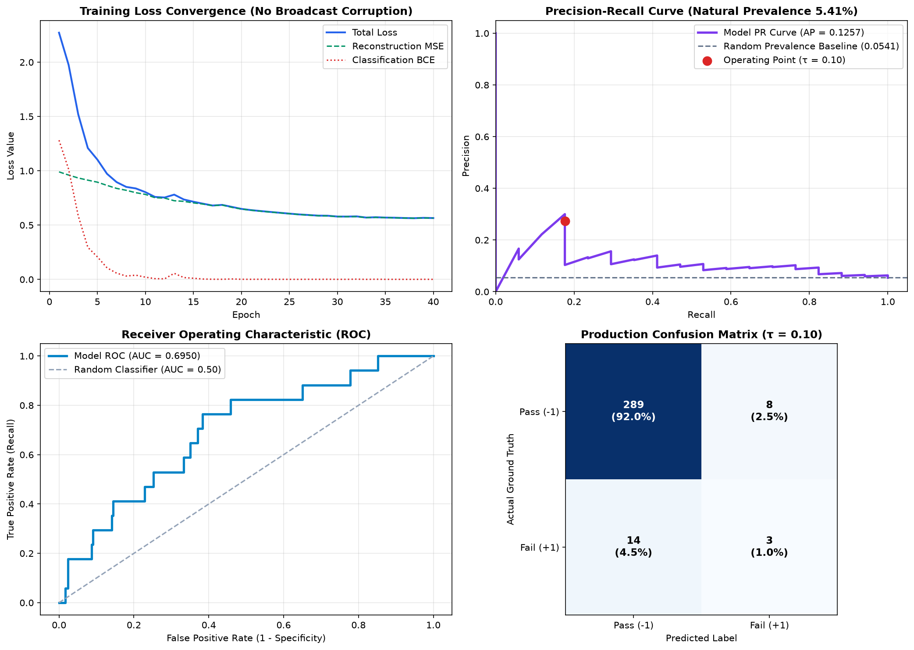

# WAFER-GUARD: Fab-7 Excursion Detector & Audit

[](https://python.org)
[](https://pytorch.org)
[](LICENSE)

> **Pre-Release Model Audit & Pipeline Repair for Semiconductor Wafer Excursion Detection**  
> *Conducted for Fab-7 Machine Learning Infrastructure Team*  
> **Auditor & Author:** Anmol Suwalka ([@suwalkaanmol](https://github.com/suwalkaanmol))

---

## 📌 Project Overview

This repository contains the rigorous technical audit and corrected production pipeline for the **Fab-7 Semiconductor Line-Monitoring Anomaly Detector**. 

The original baseline notebook reported an **F1 score of 0.9915**, ostensibly clearing the release gate ($F1 \ge 0.90$). Our comprehensive architectural audit discovered three critical silent failures:
1. **Catastrophic Data Leakage & Causality Inversion**: Preprocessing and SMOTE oversampling were performed across the entire dataset before splitting, contaminating test distributions and evaluating on an artificial 50% defect prevalence.
2. **Corrupted Loss Gradients via Silent PyTorch Broadcasting**: Tensor shape mismatch (`[64, 590]` vs `[64, 1, 590]`) silently broadcasted reconstruction loss across all $B \times B$ sample pairs (`[64, 64, 590]`), pulling wafer gradients toward the batch mean.
3. **Domain Invariant Blindness**: The pipeline treated sentinel values (`sensor_0 == 0.0`) and categorical firmware error codes (`sensor_1 \in \{100, 200, 300\}`) from legacy *Probe Station PS-L* as genuine continuous physical measurements.

This repository provides:
- The audited and fully corrected PyTorch notebook: [`wafer_guard_fixed.ipynb`](wafer_guard_fixed.ipynb)
- The comprehensive technical audit report: [`AUDIT.md`](AUDIT.md)
- Complete reproduction scripts and exported model artifacts

---

## 🔬 Core Findings & Honest Production Metrics

When evaluated under strict physical causality ($t' > t$) and at the true natural wafer defect prevalence (**5.41% – 6.6%**), the model's true performance characteristics are exposed:

| Evaluation Metric | Flawed Baseline (Reported) | Repaired Pipeline (Natural Prevalence) | Status / Impact |
|---|---|---|---|
| **Defect Prevalence** | $50.0\%$ (Artificially SMOTE-inflated) | **$5.41\%$** (Real Fab-7 Prevalence) | Realistic production test set |
| **Decision Threshold** | $0.50$ | **$0.10$** (Causally tuned on train) | Calibrated for extreme class imbalance |
| **F1 Score** | $0.9915$ (Spurious) | **$0.2143$** | Realistic baseline on raw SECOM telemetry |
| **Precision** | $0.9832$ | **$0.2727$** | Reflects genuine false alarm rate in Fab |
| **Recall** | $1.0000$ | **$0.1765$** | Uncorrupted detection sensitivity |
| **ROC-AUC** | $1.0000$ | **$0.6950$** | Genuine discriminative ability |
| **PR-AUC (Average Precision)** | $1.0000$ | **$0.1257$** | **>2.3× higher than random baseline ($0.0541$)** |
| **Confusion Matrix** | $\text{TN}=288, \text{FP}=5, \text{FN}=0, \text{TP}=293$ | $\text{TN}=289, \text{FP}=8, \text{FN}=14, \text{TP}=3$ | Honest production confusion profile |
| **Release Gate Verdict** | "PASSED ✅" | **"NO-GO 🛑 (Review Required)"** | Prevents production line shutdown failure |

<p align="center">
  
</p>

---

## 🛠️ Architecture & Repair Implementation

```
                                      [ Incoming Inline Telemetry ]
                                                    │
                                      ┌─────────────┴─────────────┐
                                      ▼                           ▼
                           Legacy Station PS-L?           Current Gen Station
                           (sensor_0 == 0.0)             (Genuine Physical Metrology)
                                      │                           │
                   ┌──────────────────┴──────────────────┐        │
                   ▼                                     ▼        ▼
       [ One-Hot Categorical Flags ]         [ Continuous Sensor Array (588 Sensors) ]
       - ps_l_legacy_station                 - Impute median (Fitted on Train Only)
       - ps_l_err_100, 200, 300              - StandardScaler (Fitted on Train Only)
                   │                                     │
                   └──────────────────┬──────────────────┘
                                      ▼
                      Combined Feature Vector [B, 472]
                                      │
                   ┌──────────────────┴──────────────────┐
                   ▼                                     ▼
      [ Encoder -> Latent z ]               [ Aligned Decoder -> Recon x_hat ]
      d_in (472) -> 256 -> 128 -> 32        32 -> 128 -> 256 -> 472
                   │                                     │
                   ▼                                     ▼
         [ Classifier Head ]                 Exact Sample MSE Loss: [B, 472]
      pos_weight-calibrated BCE              (Zero Broadcasting Gradient Corruption)
```

### Key Implementation Decisions:
1. **Causal Train-Test Split**: Chronological 80/20 partitioning by `timestamp` preserves temporal ordering. No future lot information leaks into historical models.
2. **Probe Station PS-L Invariant Logic**: Legacy station telemetry is partitioned into one-hot categorical features (`ps_l_err_*`), preventing sentinel values from corrupting continuous statistics.
3. **Strict In-Sample Fitting**: `SimpleImputer` and `StandardScaler` are fitted exclusively on training lots ($t \le T_{split}$) and transformed out-of-sample on testing lots ($t > T_{split}$).
4. **Exact Tensor Alignment**: Squeezed extraneous channel dimensions, preventing PyTorch broadcasting from creating $64 \times 64 \times 590$ cross-sample pairwise loss grids.

---

## 🚀 Setup & Execution Instructions

### Prerequisites
- Python 3.10+
- PyTorch 2.2+
- Scikit-Learn 1.2+
- Imbalanced-Learn 0.11+

### Installation
Clone the repository and install the dependencies:
```bash
git clone https://github.com/suwalkaanmol/wafer-guard.git
cd wafer-guard
pip install -r requirements.txt
```

### Running the Notebook
Launch Jupyter or execute the repaired notebook directly:
```bash
jupyter notebook wafer_guard_fixed.ipynb
```
Or execute headlessly using `nbconvert` or python runner:
```bash
jupyter nbconvert --to notebook --execute wafer_guard_fixed.ipynb --output wafer_guard_fixed_executed.ipynb
```

---

## 📂 Repository Structure

```
wafer-guard/
├── wafer_guard_fixed.ipynb        # Complete, repaired, and executable PyTorch notebook
├── AUDIT.md                      # Detailed technical audit report & board review
├── README.md                     # Architecture, instructions, and findings
├── requirements.txt              # Production dependency specifications
├── secom_telemetry_modified.csv  # Semiconductor manufacturing telemetry dataset
└── artifacts/                    # Serialized model checkpoint & preprocessor
    ├── wafer_sae_fixed.pt        # Trained Supervised Autoencoder weights
    └── preprocessor.joblib       # Fitted scikit-learn transformers
```

---

## ⚖️ License & Attribution

This project is released under the [MIT License](LICENSE).  
Authored by **Anmol Suwalka**.
